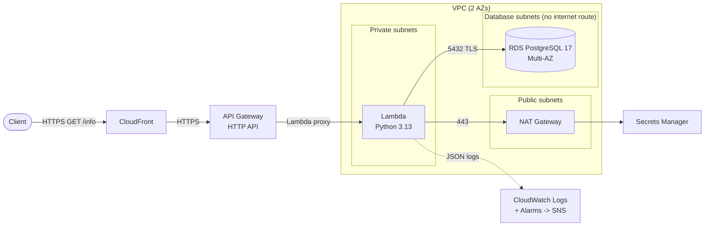

# Cloud Infrastructure Engineer Challenge: Solution

[](https://github.com/WinstonSShaw/cloud-infrastructure-engineer-challenge/actions/workflows/ci.yml)

Terraform stack that deploys a public `GET /info` endpoint on AWS. **CloudFront -> API Gateway -> Lambda (private subnet) -> RDS PostgreSQL (isolated subnet)**: the Lambda connects to the database and returns its connection status and metadata as JSON.

> The original challenge statement is in [docs/CHALLENGE.md](docs/CHALLENGE.md).

Response from the deployed stack ([full evidence](docs/evidence.md)):

```json
{
  "service": "info",
  "timestamp": "2026-11-01T21:52:34+00:00",
  "request_id": "9d944549-704c-4e47-a99b-bf80ea33a9a1",
  "database": {
    "engine": "postgresql",
    "instance_class": "db.t4g.micro",
    "multi_az": true,
    "version": "PostgreSQL 17.9 on aarch64-unknown-linux-gnu, compiled by aarch64-unknown-linux-gnu-gcc (GCC) 12.4.0, 64-bit",
    "server_version": "17.9",
    "database": "app",
    "uptime_seconds": 938,
    "ssl": true,
    "status": "connected",
    "latency_ms": 112.5
  }
}
```

If the database is unreachable the endpoint answers `503` with `"status": "unreachable"` and the error type; the full error goes to CloudWatch Logs only.

## Contents

- [Architecture](#architecture)
- [Requirements coverage](#requirements-coverage)
- [Tool selection](#tool-selection)
- [Repository layout](#repository-layout)
- [Deployment](#deployment)
- [Testing the endpoint and viewing logs](#testing-the-endpoint-and-viewing-logs)
- [Local testing with Docker](#local-testing-with-docker)
- [CI and pre-commit hooks](#ci-and-pre-commit-hooks)
- [Configuration](#configuration)
- [Cost](#cost)
- [Assumptions and constraints](#assumptions-and-constraints)
- [Suggested next steps](#suggested-next-steps)
- [Teardown](#teardown)

## Architecture



Detailed request flow, CIDR plan, security group matrix and module map: [docs/architecture.md](docs/architecture.md).

## Requirements coverage

| Requirement | Implementation |
|---|---|
| API Gateway with `GET /info` | HTTP API, single `GET /info` route, Lambda proxy integration ([modules/api_gateway](terraform/modules/api_gateway)) |
| Lambda triggered by API Gateway | Python 3.13 / arm64, invoke permission scoped to that route ([modules/lambda](terraform/modules/lambda), [lambda/src/handler.py](lambda/src/handler.py)) |
| Database in a private subnet | RDS PostgreSQL 17 in isolated subnets, not publicly accessible ([modules/database](terraform/modules/database)) |
| Lambda connects and returns status + metadata | Connection status, version, uptime, TLS in use, instance class, Multi-AZ |
| Lambda logs in CloudWatch | JSON structured logs in `/aws/lambda/<name>` with retention |
| VPC, public/private subnets, security groups | 3 subnet tiers across 2 AZs, SGs referencing each other ([modules/network](terraform/modules/network)) |
| Lambda in a private subnet using a NAT Gateway | Private subnets route `0.0.0.0/0` to a NAT Gateway in the public subnet |
| **Bonus**: High Availability | RDS Multi-AZ ([failover tested](docs/evidence.md#7-multi-az-failover-test)), subnets/Lambda in 2 AZs, optional NAT per AZ, RDS storage autoscaling |
| **Bonus**: Load Balancer or CloudFront | CloudFront in front of the API ([why not an ALB](docs/decisions.md#adr-004-cloudfront-not-an-alb-for-the-traffic-distribution-bonus)) |
| **Bonus**: Backup & DR | 7-day automated backups with point-in-time recovery, final snapshot on destroy, tags copied to snapshots |
| **Bonus**: GitHub Actions validation | `fmt`, `validate`, `tflint`, Trivy, ruff, and an end-to-end Docker test ([ci.yml](.github/workflows/ci.yml)) |
| **Bonus**: Pre-commit hooks | Linting + security checks ([.pre-commit-config.yaml](.pre-commit-config.yaml)) |
| **Bonus**: Monitoring | CloudWatch alarms for RDS CPU/storage/connections, Lambda errors/throttles, API 5xx -> SNS ([modules/monitoring](terraform/modules/monitoring)) |
| **Bonus**: Docker for local testing | PostgreSQL 17 + the official Lambda runtime image ([docker-compose.yml](docker-compose.yml)) |

## Tool selection

**Terraform** is the IaC tool. It is the preferred option in the challenge, has the most mature AWS provider, and `terraform plan` gives reviewers an exact diff before anything changes. The stack is a root module composed of six small local modules: each module owns one concern and exposes only the inputs it needs, so every networking and security decision is visible in the code instead of behind a large community module.

Other choices, with alternatives and trade-offs, are recorded as ADRs in [docs/decisions.md](docs/decisions.md):

- **RDS PostgreSQL** over a database on EC2: Multi-AZ, backups, patching and secrets management are managed features.
- **HTTP API** over REST API: simpler and ~70% cheaper for a single proxied route.
- **CloudFront** over an ALB: an ALB cannot sit in front of API Gateway.
- **RDS-managed secret** in Secrets Manager: no credential ever touches code or Terraform state.
- **Python + pg8000**: a pure-Python driver, so the package builds identically on any OS.

## Repository layout

```text
.
├── terraform/                  # Root module: wires the modules together
│   ├── main.tf  variables.tf  outputs.tf  providers.tf  versions.tf
│   ├── terraform.tfvars.example
│   └── modules/
│       ├── network/            # VPC, subnets, NAT, routes, security groups, flow logs
│       ├── database/           # RDS PostgreSQL
│       ├── lambda/             # Function, IAM role, log group
│       ├── api_gateway/        # HTTP API, GET /info, access logs
│       ├── cloudfront/         # Distribution in front of the API
│       └── monitoring/         # CloudWatch alarms + SNS
├── lambda/
│   ├── src/handler.py          # Function code
│   ├── requirements.txt
│   ├── Dockerfile              # Local runtime (Lambda base image)
│   └── events/get-info.json    # Sample API Gateway event
├── scripts/build_lambda.py     # Builds the deployment package for the Lambda platform
├── docker-compose.yml          # Local PostgreSQL + Lambda
├── docs/                       # Architecture, ADRs, security, evidence, original challenge
└── .github/workflows/ci.yml    # CI pipeline
```

## Deployment

### Prerequisites

- An AWS account and credentials with permissions to create the resources (e.g. an `AdministratorAccess` profile for a sandbox account).
- [Terraform](https://developer.hashicorp.com/terraform/install) >= 1.10
- Python 3 with `pip` (only to build the Lambda package)
- [AWS CLI v2](https://docs.aws.amazon.com/cli/latest/userguide/getting-started-install.html) (to read logs and clean up)

### Steps

```bash
# 1. Build the Lambda package (dependencies resolved for Linux arm64 / Python 3.13)
python scripts/build_lambda.py

# 2. Deploy (~15-20 min: RDS Multi-AZ and CloudFront take the longest)
export AWS_PROFILE=<your-profile>          # PowerShell: $env:AWS_PROFILE = "<your-profile>"
cd terraform
cp terraform.tfvars.example terraform.tfvars   # optional, every variable has a default
terraform init
terraform plan -out tfplan
terraform apply tfplan
```

Main outputs:

| Output | Description |
|---|---|
| `info_url` | Public endpoint through CloudFront |
| `api_gateway_info_url` | Same endpoint served directly by API Gateway |
| `lambda_log_group` | CloudWatch log group of the Lambda |
| `database_endpoint` | Private RDS endpoint (only reachable inside the VPC) |
| `database_secret_arn` | RDS-managed secret with the DB credentials |

### Remote state (team usage)

State is local by default so the stack can be deployed into any account without a bootstrap step. For shared use, add an S3 backend with native locking (Terraform >= 1.10, no DynamoDB table needed):

```hcl
# terraform/backend.tf
terraform {
  backend "s3" {
    bucket       = "<state-bucket>"
    key          = "cloud-infrastructure-challenge/terraform.tfstate"
    region       = "us-east-1"
    encrypt      = true
    use_lockfile = true
  }
}
```

## Testing the endpoint and viewing logs

```bash
curl -s "$(terraform output -raw info_url)" | jq
# PowerShell: Invoke-RestMethod (terraform output -raw info_url) | ConvertTo-Json -Depth 5

# Lambda logs (live tail)
aws logs tail "$(terraform output -raw lambda_log_group)" --follow
```

CloudWatch Logs Insights query over the Lambda log group:

```text
fields @timestamp, level, message, db_status, latency_ms
| filter message = "Database health check"
| sort @timestamp desc
```

Evidence from a real deployment (responses, logs, alarms): [docs/evidence.md](docs/evidence.md).

## Local testing with Docker

The real handler runs in the official Lambda Python 3.13 image (which includes the Runtime Interface Emulator) against PostgreSQL 17:

```bash
docker compose up --detach --build --wait

# Invoke GET /info with an API Gateway v2 event (PowerShell: use curl.exe)
curl -s -X POST http://localhost:9000/2015-03-31/functions/function/invocations \
  --data-binary @lambda/events/get-info.json | jq '.body | fromjson'

# Simulate a database outage -> 503 "unreachable"
docker compose stop postgres

docker compose down --volumes
```

Locally the function reads credentials from environment variables and does not use TLS; in AWS it uses the Secrets Manager secret and verifies the RDS certificate. CI runs this same scenario on every pull request.

## CI and pre-commit hooks

[`.github/workflows/ci.yml`](.github/workflows/ci.yml) runs on every pull request and on pushes to `main`:

| Job | What it checks |
|---|---|
| `pre-commit` | Every hook below |
| `trivy` | IaC misconfiguration scan, **blocking** on HIGH/CRITICAL (accepted risks are annotated, see [docs/security.md](docs/security.md)) |
| `lambda-local` | Docker end-to-end test: `200 connected`, then `503 unreachable` with the DB stopped |

Hooks ([`.pre-commit-config.yaml`](.pre-commit-config.yaml)): file hygiene, private key / AWS credential detection, `terraform fmt`, `terraform validate`, `tflint` (AWS ruleset), `trivy`, `ruff` (lint + bandit security rules + format).

```bash
pip install pre-commit
pre-commit install            # runs on every commit
pre-commit run --all-files    # requires terraform, tflint and trivy on PATH
```

## Configuration

All variables have defaults; see [`terraform/variables.tf`](terraform/variables.tf) and [`terraform.tfvars.example`](terraform/terraform.tfvars.example). The most relevant:

| Variable | Default | Purpose |
|---|---|---|
| `aws_region` | `us-east-1` | Target region |
| `single_nat_gateway` | `true` | `false` = one NAT Gateway per AZ |
| `db_multi_az` | `true` | RDS synchronous standby with automatic failover |
| `db_backup_retention_days` | `7` | Automated backups / PITR window |
| `db_deletion_protection` | `false` | Set `true` for production |
| `db_skip_final_snapshot` | `false` | Keep a final snapshot on destroy |
| `api_throttling_rate_limit` / `api_throttling_burst_limit` | `10` / `20` | Protects the database from request spikes |
| `alarm_email` | `null` | Email subscribed to the alarms topic |
| `log_retention_days` | `14` | Retention of every log group |

## Cost

Approximate on-demand prices in `us-east-1` with the defaults:

| Resource | ~US$/month |
|---|---|
| NAT Gateway (1) + Elastic IP | 36.5 + data processing |
| RDS `db.t4g.micro` Multi-AZ + 20 GiB gp3 | 23.4 + 4.6 |
| Secrets Manager secret | 0.4 |
| Lambda, API Gateway, CloudFront, CloudWatch | < 1 at challenge traffic |
| **Total** | **~65 / month (~2.2 / day)** |

`db_multi_az = false` saves ~US$14/month. The NAT Gateway is the largest fixed cost and is required by the challenge.

## Assumptions and constraints

- **Public, unauthenticated endpoint**: the challenge asks for a working public endpoint. It is protected by throttling and Shield Standard; production would add an authorizer and WAF ([docs/security.md](docs/security.md)).
- **The Lambda uses the RDS master credentials** (RDS-managed secret). Creating a least-privilege database user requires running SQL inside the private network, which is out of scope for a pure-Terraform deployment; it is the first production follow-up.
- **API Gateway is also reachable directly**, not only through CloudFront. Restricting the origin requires a custom domain or a secret header check.
- **One environment, local state**: variables (`environment`, `project`) and the documented S3 backend allow more environments without code changes.
- **No custom domain**: CloudFront uses its default `*.cloudfront.net` certificate.
- **No reserved concurrency on the Lambda**: new AWS accounts have a concurrency quota of 10, which makes reserving concurrency fail; API Gateway throttling bounds the load instead.
- **Disposable defaults**: deletion protection is off and a final snapshot is kept so `terraform destroy` works cleanly.

## Suggested next steps

Not implemented on purpose, to keep the solution focused on the challenge. This is the order in which I would take the stack to production:

| # | Improvement | Why |
|---|---|---|
| 1 | **Authentication and WAF**: JWT/IAM authorizer on the HTTP API, AWS WAF on CloudFront, and only accept traffic that comes through CloudFront | The endpoint is public by design for the challenge |
| 2 | **Least-privilege database user**: a read-only role created by a migration, with its own secret | The Lambda uses the RDS master secret today |
| 3 | **Continuous delivery with OIDC**: GitHub Actions assumes an IAM role (no access keys), posts `terraform plan` on each PR and applies on merge after a manual approval, with the S3 remote state | Deployments are manual from a workstation today |
| 4 | **Secrets Manager VPC endpoint** | Restricts the Lambda egress to the VPC and removes the NAT dependency for credentials |
| 5 | **RDS Proxy** | Connection pooling if traffic grows (one connection per invocation today) and shorter failovers than the ~18 s [measured](docs/evidence.md#7-multi-az-failover-test) |
| 6 | **One NAT Gateway per AZ** (`single_nat_gateway = false`) | Outbound traffic no longer depends on a single AZ (~US$36/month more) |
| 7 | **Disaster recovery across regions**: AWS Backup with cross-region copies, agreed RPO/RTO and periodic restore tests | Backups live in the same region as the database |
| 8 | **Deeper observability**: X-Ray tracing, a CloudWatch dashboard, a Synthetics canary on `/info`, CloudWatch Database Insights | Alarms say that something broke, not where |
| 9 | **Compliance hardening if required**: customer managed KMS keys, deletion protection, CloudFront access logs | Accepted risks listed in [docs/security.md](docs/security.md) |
| 10 | **More environments**: one state and `tfvars` per environment | The code is already parametrized by `project` and `environment` |

## Teardown

```bash
cd terraform
terraform destroy
# The final RDS snapshot is kept on purpose; delete it when no longer needed:
aws rds delete-db-snapshot --db-snapshot-identifier nanlabs-challenge-dev-postgres-final
```

Destroying the Lambda's VPC network interfaces can take a few minutes; this is normal.
