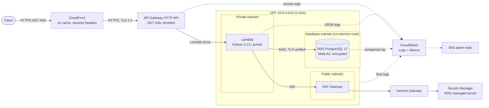

# Architecture

## Request flow

1. The client calls `https://<distribution>.cloudfront.net/info`. CloudFront forces HTTPS, does not cache (the response is live status) and forwards every header except `Host` to API Gateway.
2. API Gateway (HTTP API, `$default` stage) applies throttling (10 rps / 20 burst), writes an access log entry and invokes the Lambda with a payload v2 event.
3. The Lambda runs inside the **private subnets**. On a cold start it reads the database credentials from the RDS-managed secret in **Secrets Manager**; that public AWS API is reached through the **NAT Gateway**.
4. It opens a TLS connection to **RDS** (certificate verified against the RDS CA bundle), runs one metadata query and closes the connection.
5. It returns `200` with the connection status and database metadata, or `503` if the database is unreachable. Each invocation logs a structured JSON line to **CloudWatch Logs**.

## Network layout

| Tier | CIDRs (AZ a / AZ b) | Route to the internet | Contains |
|---|---|---|---|
| Public | `10.0.0.0/24`, `10.0.1.0/24` | Internet Gateway | NAT Gateway (+ Elastic IP) |
| Private | `10.0.10.0/24`, `10.0.11.0/24` | NAT Gateway | Lambda ENIs |
| Database | `10.0.20.0/24`, `10.0.21.0/24` | none | RDS primary + standby |

## Security groups

| Security group | Inbound | Outbound |
|---|---|---|
| `*-lambda` | none | `5432` to `*-database` SG; `443` to `0.0.0.0/0` (Secrets Manager via NAT) |
| `*-database` | `5432` from `*-lambda` SG only | none |
| default | none (all rules removed) | none |

## Terraform modules

| Module | Responsibility |
|---|---|
| `modules/network` | VPC, subnets, IGW, NAT, route tables, security groups, flow logs |
| `modules/database` | RDS PostgreSQL, subnet group, parameter group, log export |
| `modules/lambda` | Function, IAM role, log group, packaging |
| `modules/api_gateway` | HTTP API, `GET /info` route, stage, access logs, invoke permission |
| `modules/cloudfront` | Distribution in front of the API |
| `modules/monitoring` | CloudWatch alarms and SNS topic |

The root module (`terraform/`) only wires the modules together. Dependencies flow one way: `network -> database -> lambda -> api_gateway -> cloudfront`, with `monitoring` observing all of them.
